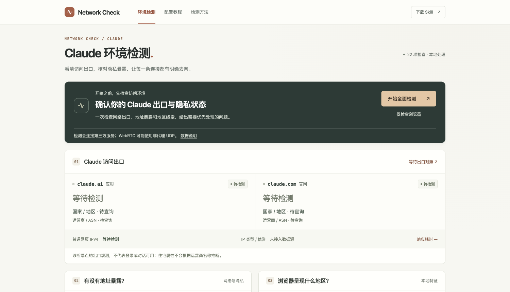
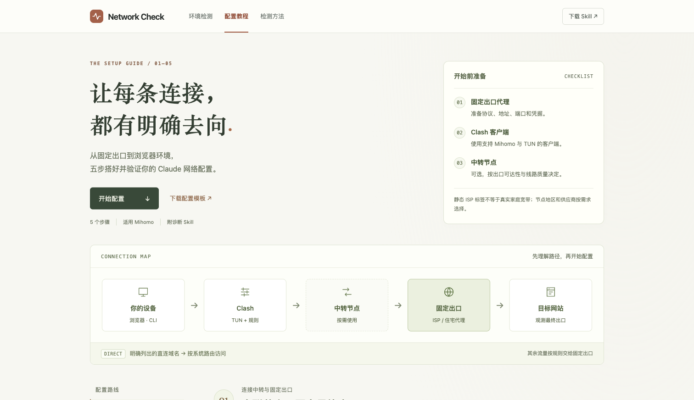

# Claude Network Check

一个已部署到 GitHub Pages 的浏览器网络检测页，附 5 步图文教程和 Agent Skill。独立项目，与 Anthropic / Claude / IPPure 无关联。

- 先给结论，再展示 Claude 出口、地址暴露、地区特征和修复建议；每项可展开证据。
- 22 项检测：10 项网络观测、12 项浏览器与设备检查。
- 覆盖两个 Claude 出口、三次 DNS 观测、WebRTC 地区、中文字体和 Emoji；新增出口一致性、HTTP 稳定性、语言/时区一致性等。
- 本地读取时区、语言、字体线索；透明的实验性参考值，不是官方风险分数。
- 点击后才联网；无 API 密钥、无遥测、无持久化，报告默认脱敏。
- 免费外部服务可限流或失败；未知始终显示未知，不承诺无泄露或账号安全。

**在线检测：[claude-network-check.github.io](https://claude-network-check.github.io/)** · [配置教程](https://claude-network-check.github.io/guide.html) · [下载 Skill](https://claude-network-check.github.io/downloads/claude-network-setup.zip)



教程包含准备清单、连接流程图、五步目录、可复制配置片段与逐步验证要点。



## 本地运行

需要 Node.js 22 或更新版本，无需安装依赖。

```bash
npm test
npm run build
npm run dev
```

打开 http://127.0.0.1:4173 。开发服务器仅绑定回环地址；修改后重新 build 并刷新。

## 内容

- [简短图文教程](docs/guide.zh-CN.md)
- [与 IPPure Claude 页逐项对照](docs/coverage.zh-CN.md)
- [免费 API 与纯前端调研](docs/research.zh-CN.md)
- [实现与浏览器测试记录](docs/validation.md)
- [Skill](skills/claude-network-setup/SKILL.md) / [Mihomo 模板](skills/claude-network-setup/assets/mihomo.template.yaml)
- [推文草稿](docs/thread.zh-CN.md)

构建生成 dist/，包含网页、可阅读的教程/调研页、原始文档、Skill 和下载 ZIP。Skill 解压后，将 claude-network-setup 文件夹放入你的 Agent 支持的 skills 目录，显式调用 `$claude-network-setup`。技能不会随网页运行。

## 发布到 GitHub Pages

默认部署地址：https://claude-network-check.github.io/

部署到自己的账号或组织时：

1. 自行创建 GitHub 仓库并推送此项目。
2. Settings → Pages → Source 选择 GitHub Actions。
3. 推送到 main，或在 Actions 手动运行 Deploy Pages 工作流。
4. 使用不同地址时，在构建步骤设置 `SITE_URL=https://你的域名/路径/`，使 canonical、社交分享链接和 sitemap 与部署地址一致。

工作流在 main 推送时自动发布，也支持手动触发。资源路径支持 /仓库名/ 子目录，无后端和密钥。免费 API 的共享额度可能不适合大流量，尤其 ipwho.is 当前按网站域名共享 1,000 次/日；详见调研。

## 实现

site/ 使用原生 HTML、CSS 与 ES Modules；scripts/ 提供静态构建、ZIP 打包和本地服务器。测试用 Node 内置 test runner。无运行依赖、无外部字体、无统计脚本。

请勿将节点凭据、订阅地址、原始检测结果、本机路径或私人截图提交到仓库。许可证只覆盖本项目，不授予第三方 API 的额外使用权。
