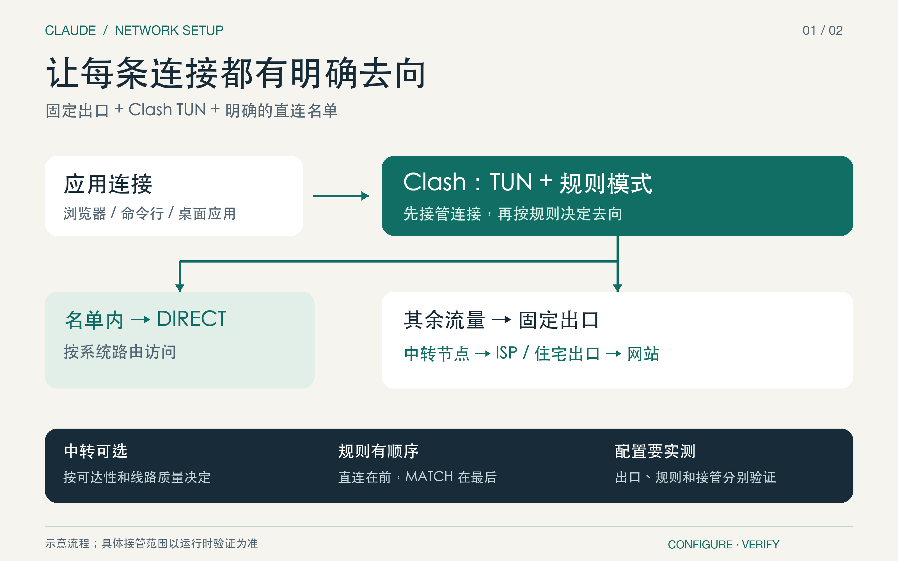
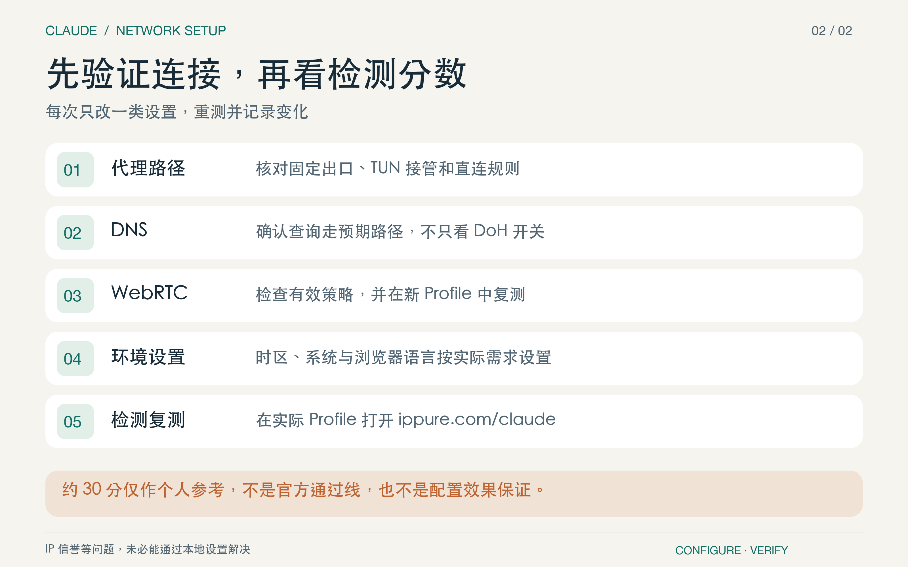

# Claude 网络环境配置：5 步搭好固定出口

准备三样：海外中转节点、固定住宅／ISP 代理、支持 Mihomo 的 Clash 客户端。中转可选，国家和供应商按需求选择；“静态 ISP”不等于真实家庭宽带。



## 1. 串联节点，固定最终出口

路径：设备 → 中转 → 固定出口 → 网站。在出口节点中添加 `dialer-proxy: RELAY`，其中 `RELAY` 是中转节点名。填写实际协议、端口和凭据，不能只添加两个独立节点。

[下载配置模板](../skills/claude-network-setup/assets/mihomo.template.yaml)，替换全部 `REPLACE_WITH_*` 后再导入。模板使用 AnyTLS → SOCKS5，其他协议按服务商资料调整。

> **验证要点**：代理客户端中选中固定出口，确认它实际经由指定中转连接；中转节点需要独立可用。

## 2. 用 TUN 接管，用规则分流

TUN 验证接管成功后，通常可关闭系统代理，应用也不必重复指定代理。将明确需要直连的域名放前面，其他流量交给固定出口：

```yaml
rules:
  - DOMAIN-SUFFIX,example.com,DIRECT # 替换为自己的直连域名
  - MATCH,ISP-EXIT
```

模板已包含通用本地地址例外。不要把系统代理绕过名单当成 TUN 分流规则。

> **验证要点**：检查客户端连接记录，直连域名命中 DIRECT，其余目标命中固定出口；终端需要单独验证。

## 3. 让 DNS 也走预期路径

模板通过 `#ISP-EXIT` 让公共 DoH 查询经过固定出口。代理端点需填写数字 IP，避免代理和 DNS 相互依赖。若把系统 DNS 改为 `127.0.0.1`，先确认 Clash DNS 正常监听，并保持 Clash 运行。

> **验证要点**：用检测页查看 DNS 样本与 ECS；解析器地区只是线索，不能单凭国家不同就判定泄露。

## 4. 核对浏览器的环境信号

按需求设置时区、系统语言和浏览器语言。WebRTC 可使用 `disable_non_proxied_udp`；macOS Chrome 示例：

```bash
defaults write com.google.Chrome WebRtcIPHandling -string disable_non_proxied_udp
```

在 `chrome://policy` 重载并确认生效；其他浏览器先确认支持方式。这是默认策略，可能被覆盖。新 Profile 要复测，修改旧 Profile 不代表未来账号自动继承。

> **验证要点**：在实际使用的浏览器 Profile 中重测。WebRTC 没有采集到地址只表示本次结果，不是无泄露证明。

## 5. 回到检测页，逐项验证

在实际使用的 Profile 打开[本项目检测页](../index.html)，也可使用 [IPPure](https://ippure.com/claude) 交叉核对。先核对出口、DNS 和 WebRTC，再检查环境字段。每次只改一类设置，重测并记录。



不同检测工具的分数不能直接比较；约 30 分不是官方通过线。IP 信誉等问题未必能靠本地设置解决。

需要 Agent 协助，可安装随附 Skill，调用 `$claude-network-setup`。它会检查配置来源、备份、修改并验证；完整参数和排查细节都留在 Skill 中。
